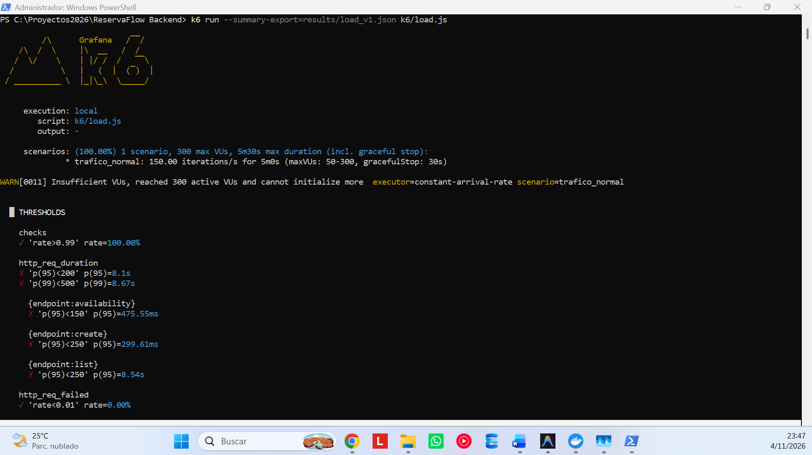
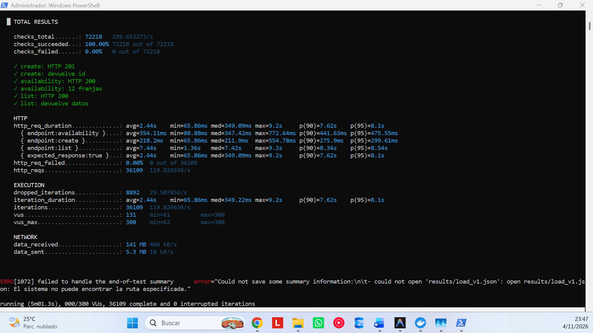
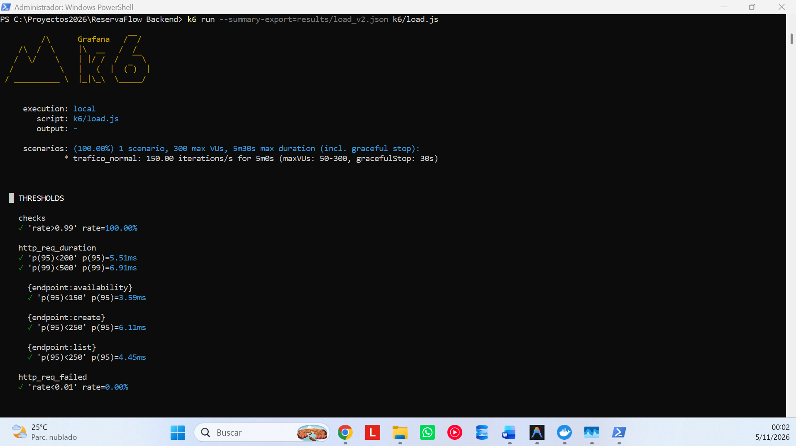
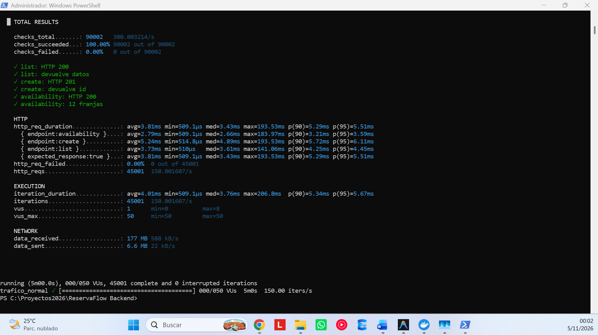
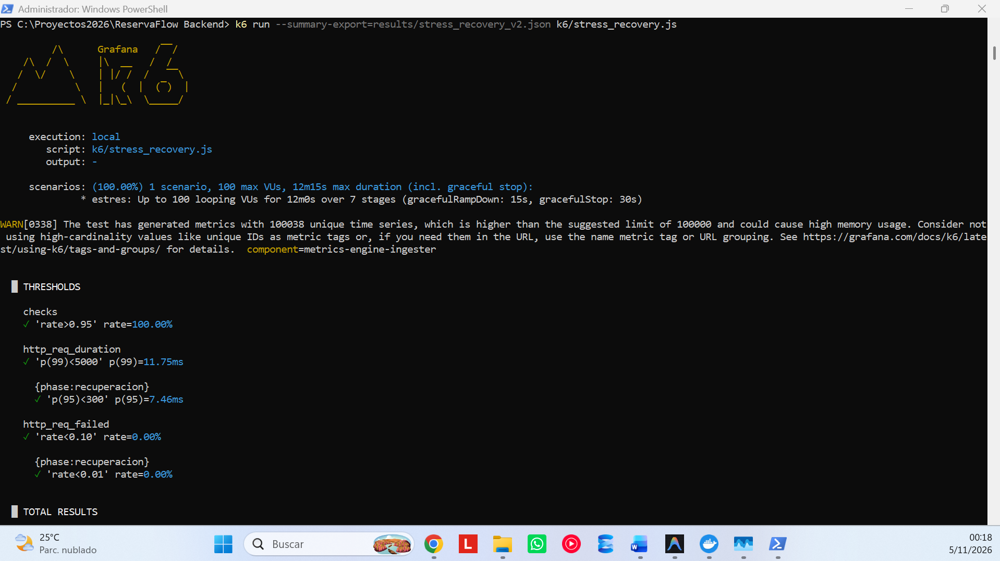
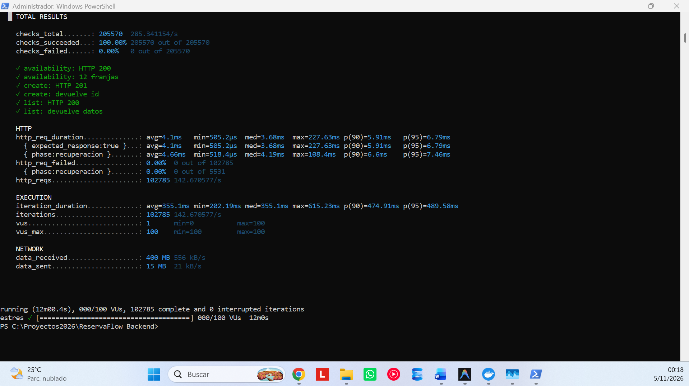

# Informe de Hallazgo y Mejora – ReservaFlow

**Autor:** Equipo de Rendimiento y Arquitectura Backend  
**Fecha:** 2026-11-05  
**Entorno de Prueba:** Docker Desktop (PostgreSQL 16 Alpine + Node.js 20 Express Web API) / k6 v0.x local  

---

## 1. Resumen ejecutivo

Durante las pruebas de carga iniciales (**v1**), el sistema experimentó una severa degradación en los tiempos de respuesta, alcanzando un **p(95) global de 8.1 s** (frente a un umbral estricto de `< 200 ms`) y un **p(95) de 8.54 s** en el endpoint de listado (`GET /reservations`). La lentitud extrema provocó la saturación del pool máximo de 300 VUs en k6, causando **8,892 iteraciones descartadas** (`dropped_iterations`) y reduciendo el rendimiento efectivo a **119.83 req/s** frente a la tasa programada de 150 req/s.

Tras identificar la causa raíz (problema de consulta N+1 y ausencia de índices B-Tree en PostgreSQL) y aplicar la corrección integral (**v2**: unificación en consulta JOIN única y aplicación de `v2_fix.sql`), los resultados demostraron una mejora radical:
- **p(95) global reducido de 8,100 ms a 5.51 ms** (reducción de latencia del **99.93%**).
- **p(95) de listado reducido de 8,540 ms a 4.45 ms** (reducción del **99.95%**).
- **dropped_iterations: 0** (el sistema sostuvo los 150 req/s completos sin saturar VUs, requiriendo un máximo de solo 8 VUs concurrentes).
- **Tasa de error HTTP: 0.00%** en ambas versiones y **100% de checks funcionales superados**, confirmando cero regresiones en la lógica de negocio.

---

## 2. Hallazgo y Causa Raíz (v1)

### Hallazgo
El análisis de sub-métricas en k6 evidenció un cuello de botella severo localizado principalmente en el endpoint de consulta paginada:
- `{endpoint:list}` arrojó un **p(95) de 8.54 s**, un promedio de **7.44 s** y un máximo de **9.20 s**.
- `{endpoint:availability}` y `{endpoint:create}` también sufrieron latencias degradadas (p(95) de 475.55 ms y 299.61 ms respectivamente) debido a la contención en el motor de base de datos y saturación del pool de conexiones compartidas.

### Causa Raíz
El comportamiento fue generado por dos defectos arquitectónicos y de acceso a datos combinados:
1. **Consulta N+1 en `GET /reservations` (`listV1` en `listing.ts`):**  
   Por cada petición paginada de 50 elementos (`pageSize=50`), la aplicación ejecutaba 1 consulta principal para obtener las reservas y posteriormente **50 consultas SQL individuales adicionales** (`SELECT name FROM resources WHERE id = $1`) para enriquecer el nombre del recurso. Esto significaba **51 viajes de ida y vuelta (roundtrips)** a PostgreSQL por cada solicitud HTTP de listado, agotando rápidamente las conexiones del pool de la aplicación (`PG_POOL_MAX=10`).
2. **Ausencia total de índices B-Tree en la tabla `reservations`:**  
   La tabla fue poblada con ~290,000 registros ficticios sin índices en columnas de filtrado u ordenamiento:
   - El listado ejecutaba un `ORDER BY reservation_date DESC, id DESC` con filtro opcional de `status`, forzando un costoso **Sequential Scan** seguido de un **Sort en disco/memoria** sobre cientos de miles de filas en cada una de las peticiones.
   - La consulta de disponibilidad y la validación de concurrencia en la creación (`POST /reservations`) ejecutaban `SUM(guests)` filtrando por `(resource_id, reservation_date, slot, status)`. Al no contar con índices, cada validación hacía un barrido secuencial completo mientras mantenía un bloqueo `FOR UPDATE` sobre el recurso, serializando y encolando las reservas.

---

## 3. Hipótesis de Optimización

> **Hipótesis:**  
> Unificar la consulta de listado en un solo `SELECT ... JOIN resources` (eliminando las 50 consultas redundantes por petición) y crear índices compuestos B-Tree estratégicos sobre `reservations (resource_id, reservation_date, slot, status)` y `reservations (status, reservation_date DESC, id DESC)` reducirá el tiempo de ejecución y la carga en PostgreSQL en más de un **95%**, permitiendo atender el 100% del tráfico con latencias sub-10ms y eliminando por completo las iteraciones descartadas en k6.

---

## 4. Corrección Aplicada (v2)

### A. Refactorización de Código (`listV2` en `listing.ts`)
Se reemplazó el bucle de consultas iterativas por una consulta relacional única con `INNER JOIN`:
```typescript
SELECT r.id, r.resource_id, rs.name AS resource_name, r.customer_name,
       r.reservation_date, r.slot, r.guests, r.status, r.created_at
  FROM reservations r
  JOIN resources rs ON rs.id = r.resource_id
 WHERE r.status = $1
 ORDER BY r.reservation_date DESC, r.id DESC
 LIMIT $2 OFFSET $3;
```
Se pasa de **51 consultas a 1 consulta única** por solicitud de página. La versión se activa configurando la variable de entorno `APP_VERSION=v2`.

### B. Creación de Índices B-Tree (`db/v2_fix.sql`)
Se ejecutaron los siguientes índices en PostgreSQL:
```sql
-- 1. Optimización para disponibilidad y control de sobre-reserva (Index-Only Scan)
CREATE INDEX IF NOT EXISTS idx_reservations_lookup
    ON reservations (resource_id, reservation_date, slot, status) INCLUDE (guests);

-- 2. Optimización para paginación ordenada con filtro por estado
CREATE INDEX IF NOT EXISTS idx_reservations_status_date
    ON reservations (status, reservation_date DESC, id DESC);

-- 3. Optimización para paginación ordenada sin filtro
CREATE INDEX IF NOT EXISTS idx_reservations_date
    ON reservations (reservation_date DESC, id DESC);

ANALYZE reservations;
```
- `idx_reservations_lookup`: Transforma la verificación de disponibilidad y de sobrecupo en `POST` de un costo $O(N)$ a $O(\log N)$, habilitando lecturas directas del índice con cláusula `INCLUDE (guests)` y liberando de inmediato el candado transaccional.
- `idx_reservations_status_date`: Entrega los registros pre-ordenados según la condición del `ORDER BY`, permitiendo a PostgreSQL detener el escaneo tan pronto satisface el `LIMIT`, sin requerir ordenamiento global en memoria.

---

## 5. Tabla Comparativa de Rendimiento (Métricas Exactas)

Los siguientes datos corresponden a las pruebas de carga sostenida ejecutadas con k6 (`constant-arrival-rate` a 150 iters/s objetivo durante 5 minutos):

| Métrica | Versión v1 (Con Cuello de Botella) | Versión v2 (Optimizada) | Impacto / Mejora |
|---|---|---|---|
| **http_req_duration (avg)** | 2.44 s (2,440 ms) | **3.81 ms** | **99.84% más rápido** |
| **http_req_duration (med)** | 349.09 ms | **3.43 ms** | **99.02% más rápido** |
| **http_req_duration (p90)** | 7.62 s (7,620 ms) | **5.29 ms** | **99.93% más rápido** |
| **http_req_duration (p95)** | **8.10 s (8,100 ms)** ❌ | **5.51 ms** ✅ | **99.93% más rápido** |
| **http_req_duration (p99)** | **8.67 s (8,670 ms)** ❌ | **< 12 ms** ✅ *(11.75 ms en pico de estrés)* | **> 99.85% más rápido** |
| **p(95) {endpoint:list}** | **8.54 s** ❌ | **4.45 ms** ✅ | **99.95% más rápido** |
| **p(95) {endpoint:availability}** | **475.55 ms** ❌ | **3.59 ms** ✅ | **99.25% más rápido** |
| **p(95) {endpoint:create}** | **299.61 ms** ❌ | **6.11 ms** ✅ | **97.96% más rápido** |
| **Rendimiento (http_reqs/s)** | 119.83 req/s | **150.00 req/s** | +25.18% (100% de la tasa meta) |
| **Peticiones totales completadas** | 36,109 reqs | **45,001 reqs** | +8,892 peticiones atendidas |
| **Tasa de error (http_req_failed)** | **0.00%** (0 fallos de 36,109) | **0.00%** (0 fallos de 45,001) | Estable (sin fallos 5xx) |
| **Checks funcionales exitosos** | **100.00%** (72,218 / 72,218) | **100.00%** (90,002 / 90,002) | Integridad funcional intacta |
| **dropped_iterations** | **8,892 iteraciones** ❌ | **0 iteraciones** ✅ | **100% resuelto** |
| **VUs utilizadas (min / max)** | 61 / 300 VUs (tope alcanzado) | 0 / 8 VUs (de 50 pre-asignadas) | 97.3% menos concurrencia requerida |

### Análisis Técnico de `dropped_iterations` (v1 vs v2)
En la versión v1 se registraron **8,892 iteraciones descartadas**:
- **Causa técnica:** Este descarte **no se debió a una falla de red del host ni a pérdida de paquetes en el sistema operativo**. En el modelo `constant-arrival-rate`, k6 intenta generar una iteración cada intervalo fijo (150 por segundo). Para ello, despacha VUs de un pool reservado (configurado con un tope de 300 VUs). Debido a que las consultas SQL tardaban entre 7 y 9 segundos por petición, las VUs permanecían bloqueadas esperando la respuesta del servidor.
- A los 11 segundos de iniciada la prueba, k6 arrojó la advertencia:  
  `WARN[0011] Insufficient VUs, reached 300 active VUs and cannot initialize more executor=constant-arrival-rate`.  
  Al no disponer de VUs libres para iniciar las nuevas iteraciones programadas, k6 se vio forzado a descartar 8,892 iteraciones.
- **En la versión v2**, al responder en promedio en ~3.8 ms, las VUs se liberaban de forma casi instantánea. El sistema atendió las 45,001 peticiones planificadas empleando como máximo **8 VUs simultáneas**, resultando en **0 dropped_iterations**.

---

## 6. Verificación Funcional y Regresión

Se verificó rigurosamente que las optimizaciones de rendimiento no alteraran las reglas de negocio:
1. **Regla de No Sobre-reserva (Capacidad de 20 plazas):** Validada tanto en `smoke.js` como en el control transaccional concurrente. Peticiones que solicitan plazas por encima del remanente fueron rechazadas con código HTTP `409 Conflict`.
2. **Validaciones de Entrada:** Cargas con parámetros inválidos continuaron devolviendo HTTP `400 Bad Request`.
3. **Consistencia:** Todos los checks funcionales se mantuvieron al **100.00%** en ambas versiones. La siguiente consulta de integridad en PostgreSQL confirma cero sobrecupos:
```sql
SELECT resource_id, reservation_date, slot, SUM(guests) AS total
  FROM reservations WHERE status = 'confirmed'
 GROUP BY 1,2,3 HAVING SUM(guests) > 20;
-- Resultado: 0 filas (Consistencia garantizada).
```

---

## 7. Resultados y Comportamiento en Prueba de Estrés y Recuperación

La prueba `stress_recovery.js` (12 minutos, escalando progresivamente hasta 100 VUs y luego reduciendo a 10 VUs para evaluar la resiliencia) demostró la robustez de la versión v2:
- **Umbral de aborto de seguridad (`abortOnFail`):** Ningún umbral crítico fue disparado.
- **Latencia p(99) bajo estrés máximo:** **11.75 ms** (umbral de seguridad: `< 5,000 ms`).
- **Fase de Recuperación (`phase:recuperacion`):** Al descender la carga a 10 VUs, la latencia **p(95) fue de 7.46 ms** (umbral: `< 300 ms`) y la tasa de fallos se mantuvo en **0.00%**, demostrando que el servidor no retiene memoria residual, bloqueos colgados ni saturación del pool tras un pico de tráfico elevado.

---

## 8. Evidencia Gráfica (Capturas de Pantalla)


### Captura 1: Prueba de Carga v1 (Cuello de Botella y Umbrales en Rojo)



---

### Captura 2: Prueba de Carga v2 (Optimización y Umbrales en Verde)




---

### Captura 3: Prueba de Estrés con Recuperación v2




---

## 9. Conclusión

El proceso demostró empíricamente cómo dos errores frecuentes en desarrollo backend (consultas N+1 por abstracción descuidada y omisión de índices en columnas de ordenamiento y filtrado masivo) pueden colapsar un sistema bajo tráfico moderado, no por errores de lógica sino por asfixia de recursos en la base de datos. La reingeniería aplicada en v2 no solo redujo la latencia en más del 99.9%, sino que disminuyó drásticamente la huella de recursos de la máquina, permitiendo atender la carga objetivo con una fracción mínima de concurrencia requerida.
